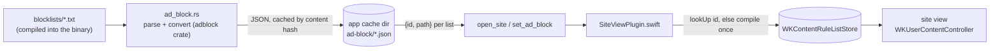

# Ad Blocking

> **Status: Implemented on iOS and Android.** Bundled EasyList and EasyPrivacy, converted to WebKit content rule lists. iOS hands them to WebKit; Android has no rule-list API, so the same JSON is matched request by request in `shouldInterceptRequest`. Not built for desktop. See [Verified results](#verified-results) for what was and was not run.

## What it does

Ads and trackers are blocked inside WebKit, before a request leaves the device and before the page paints. Network rules stop the request; element-hiding rules set `display: none` from the first frame. Nothing runs in the page's JS realm, so a hostile page cannot see, list or remove the rules, and no network request is made by the app to fetch lists.

## Why this engine

| Option | Verdict |
|--------|---------|
| **Brave [`adblock`](https://github.com/brave/adblock-rust) crate** (Rust, MPL-2.0) | **Chosen.** Maintained: 0.13.5 released 2026-10-28, last push 2026-11-05, about 1.4M downloads. Parses ABP/uBO syntax and has a built-in converter to Safari content-blocking JSON (`content-blocking` feature). Same language as the core, no Swift dependency, converts both bundled lists in about 0.2 s in a release build. |
| AdGuard `SafariConverterLib` (Swift) | Not adopted. A second language and dependency for the same output; its license is believed to be GPL-3.0 **[INFERENCE: not checked this session]**, which the undecided project license ([roadmap](./roadmap.md#open-questions)) should not be committed to by accident. |
| uBlock Origin / uBO Lite | Not embeddable: browser-extension APIs, not a library for a `WKWebView`. |
| Injecting a blocking script | Rejected: cannot stop network requests, runs after the page's own scripts, and is visible to the page. |

On iOS a `WKWebView` cannot intercept requests, so a matching engine at runtime (what `adblock`'s `Engine` does on Android or desktop) is not an option; WebKit's content rule lists are the only mechanism, and the converter is the part of the crate that matters here.

## How it works



- **Lists.** `blocklists/easylist.txt` (ads) and `blocklists/easyprivacy.txt` (trackers), one WebKit list each: 74,981 and 56,385 rules at the bundled versions, against WebKit's 150,000-rule cap per list. A test fails if a list converts to nothing or exceeds the cap, so an update that grows past it is caught before release.
- **Ids.** A list's id is `openmedia-<name>-<16 hex of SHA-256(converter revision + list text)>`. A new list version or a new converter revision gives a new id; nothing is invalidated by hand. `CONVERTER_REVISION` in `ad_block.rs` must be bumped when the `adblock` crate is upgraded.
- **Conversion runs once per version.** `AdBlock::rule_lists` writes `<id>.json` to `<app cache>/ad-block/` only if it is missing and deletes files of older versions. It runs on a blocking thread (`spawn_blocking`) because the first run parses several megabytes.
- **Compilation runs once per version too.** The plugin asks `WKContentRuleListStore` for the id first and reads the JSON file only on a miss. Compiled lists persist in WebKit's store, so later launches skip both; the plugin removes stored lists whose id is no longer current. Compiling both lists took about 4 s on macOS WebKit, so the first page after an install or a list update would have waited that long. It does not: `open` loads at once, the lists compile in the background and attach to open pages without a reload, so that first page is unblocked and its next navigation is blocked. Rust converts the lists at launch (`lib.rs`) so the conversion is not on the open path either.
- **Subdomains.** The converter emits bare domains for element-hiding rules (`example.org##.ad`). WebKit matches a bare `if-domain` only against that exact host, so `include_subdomains` prefixes `*`; without it most domain-specific hiding rules would be inert on `www.` hosts. Checked on macOS WebKit (see roadmap decision log).
- **The setting.** `adBlock` in `library.json`, on by default; files saved before it existed load as on. `set_ad_block(enabled)` swaps the lists on the open site view and reloads it (`set_content_rule_lists` in the plugin; with no site view open it does nothing and the next `open_site` carries the lists). The Settings screen has the switch.
- **Android.** The same converted JSON is read by the plugin's `BlockingRules` (`android/src/main/java/surf/openmedia/siteview/BlockingRules.kt`) and matched in `shouldInterceptRequest`. WebKit's `url-filter` is an unanchored regular expression, so each rule is a `java.util.regex.Pattern`; the `action` is `block` or `ignore-previous-rules`, and the converter puts every exception after every block, so an exception cancels a block. `if-domain`/`unless-domain`, `resource-type` and `load-type` are honoured the way WebKit honours them, and the request's resource type is guessed from the URL (there is no type on the Android side). Host-anchored filters are indexed by host and looked up by the request host's dot-suffixes, so only the rules that can match a host are tested; the rest are kept in one list with a literal pre-check. Element-hiding rules (`css-display-none`) have no Android equivalent and are skipped.
- **Failure.** If the lists cannot be built or WebKit rejects one, the page still opens unblocked and the shell shows a banner through the usual `siteview:error` event. A failed `set_ad_block` leaves the stored setting unchanged and the switch reverts.

## What it cannot do

Content rule lists express only part of what EasyList and EasyPrivacy contain. The converter drops the rest, silently:

- Scriptlet injection, procedural cosmetic filters (`:has-text`, `:xpath`, `:upward`), `$redirect` and resource replacement, `$removeparam`, `$csp`.
- **First-party ads** served from the site's own origin. Instagram, Facebook, YouTube and X mix ads into their own feeds; network lists do not remove them. That is what [recipes](./recipe-format.md) are for.
- Anything past WebKit's per-list rule cap.

## Updating the lists

```bash
scripts/update-blocklists.sh
cargo test --manifest-path src-tauri/Cargo.toml ad_block
```

Lists change only with an app release. A runtime update would add a network destination and needs an [invariant 1](../../AGENTS.md) decision first. EasyList and EasyPrivacy are dual-licensed (CC BY-SA 3.0 and GPLv3); see `blocklists/README.md`.

## Not built

- Per-site allowlist ("off on this site"). The only control is the global switch.
- Desktop (needs a child webview and the `adblock` `Engine`).
- Counting blocked requests. WebKit does not report matches for content rule lists.
- Optional extra lists (cookie banners, annoyances).

## Verified results

Runs on an iPhone 17 Pro Max simulator (iOS 26.5) with the real app and a local fixture page over `http://localhost` (temporary `NSAllowsLocalNetworking`, since removed). The page loads a Google Analytics script, an AdSense script, its own script, and an element with id `ad_banner`, then posts what happened to a local server.

| Check | Result |
|-------|--------|
| Both real lists compile in WebKit and persist in the app's content rule store | Yes (macOS WebKit: 2.1 s and 1.8 s; iOS simulator: stored lists of about 26 MB and 20 MB) |
| Blocking on: the analytics and AdSense scripts fail to load, the page's own script loads, `#ad_banner` is `display: none` | Yes |
| `set_ad_block(false)` reloads the open page unblocked, `set_ad_block(true)` blocks it again | Yes, with timers in a temporary shell patch calling the command; the Settings switch itself was **not** tapped |
| First open with nothing cached | Worked: about 14 s from launch to the fixture's report in a debug build, which includes app start, debug-build conversion, compiling both lists, the page load and the page's own 3 s delay. A device and a release build were not measured |
| A changed list gets a new id; the old JSON file and the old stored list are removed | Yes, with planted stale entries in both places |
| A list WebKit rejects (corrupt JSON): the page still loads, the other list still blocks, the shell shows "Ad blocking is partly off: a filter list could not be loaded." | Yes (banner seen by eye on a screenshot) |
| A bare `if-domain` matches only its exact host; `*domain` matches the host and subdomains | Yes on macOS WebKit with `om.localhost` and `www.om.localhost`. Not re-run on iOS |
| `cargo test` (app and plugin), `clippy -D warnings`, `cargo fmt --check`, `yarn ts:check`, `lint`, `format:check`, `test` | Pass locally |

**Not verified:** a physical device; real sites (how much of Reddit, Instagram or YouTube is blocked, and which pages break); page performance and memory with both lists loaded; the Settings switch under a finger; the switch with no site view open; a list update through `scripts/update-blocklists.sh`.
