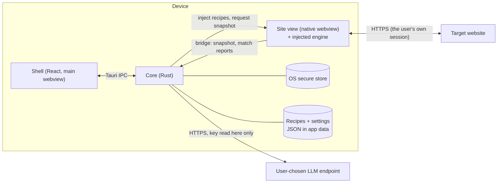
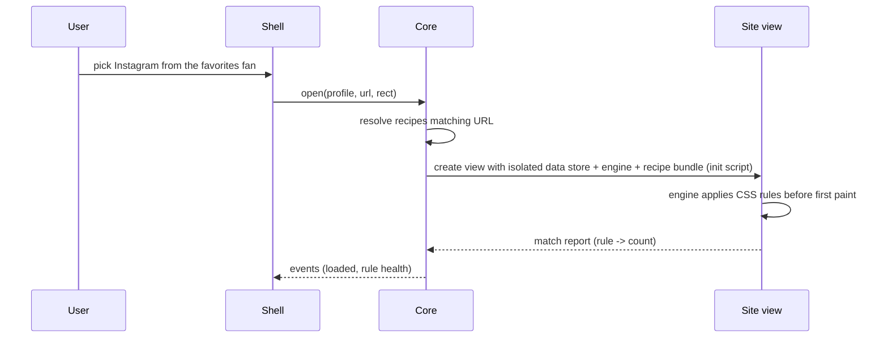

# Architecture

> **Status: Design.** Describes the intended system. Nothing here is implemented yet.

## Overview

OpenMedia has three trust zones:

| Zone | What runs there | Trust |
|------|-----------------|-------|
| **Shell** | Our React UI in the Tauri main webview | Trusted. Has IPC to Rust. |
| **Core** | Rust (`src-tauri`): recipe store, validation, AI providers, secret store, site-view control | Trusted. Only place that sees API keys. |
| **Site view** | A separate native webview showing a third-party site, plus our injected engine | **Hostile.** Arbitrary remote code. No IPC except the bridge. |



## Why a native webview, not an iframe or a proxy

- **iframe:** Instagram, YouTube, X and most targets send `X-Frame-Options` / `frame-ancestors`. They refuse to render in a frame.
- **Proxy/rewriting server:** would be a backend (rejected), and would route the user's credentials through it.
- **Native webview loading the real site directly:** the user logs in to the real origin, cookies stay in the webview's own store, and we inject our engine into the page. SocialLite's FAQ describes the same user-visible shape (the account opens inside its own app with a session cookie kept on device); that it is an injected webview is inferred, not stated by them (see [Prior Art](./prior-art.md)).

## Components

### SiteView (Rust, two implementations)

One trait, two backends. Everything above it is platform-agnostic.

| Operation | Purpose |
|-----------|---------|
| `open(profile, url, rect)` | Create the site view with the profile's isolated data store, below the transparent shell |
| `set_rect(rect)` / `set_interactive_regions(rects)` | The shell owns layout: where the page draws, and which regions of the screen belong to the shell rather than the page |
| `navigate`, `back`, `forward`, `reload` | Browser controls |
| `set_recipes(bundle)` | Push the resolved recipe bundle for this site; engine re-applies live |
| `request_snapshot(opts)` | Ask the engine for a pruned, redacted DOM snapshot |
| `events` | Stream: navigation, title, load state, match reports, picker results |

- **Desktop** (macOS/Windows/Linux): Tauri child webview via `Window::add_child` (needs the `unstable` Cargo feature) plus `initialization_script`.
- **Mobile** (iOS/Android): `add_child` is not supported on mobile (upstream [tauri#11794](https://github.com/tauri-apps/tauri/issues/11794), open). An in-repo Tauri plugin hosts a native `WKWebView` / Android `WebView` and exposes the same trait. See [Platform Support](./platform-support.md).

### Recipe store (Rust)

Recipes are JSON files in the app data dir, one per recipe. Bundled recipes ship inside the binary. The store resolves "which recipes apply to this URL" and merges them into one bundle for the engine. See [Recipe Format](./recipe-format.md).

### AI service (Rust)

Provider trait with adapters for Anthropic, OpenAI, Google Gemini, OpenRouter, and any OpenAI-compatible base URL (covers local Ollama/LM Studio). Calls are made from Rust, so there is no CORS problem and the key never enters a webview. See [AI Assistant](./ai-assistant.md).

### Secret store (Rust)

API keys go in the OS credential store: Keychain (macOS/iOS), Credential Manager (Windows), Secret Service (Linux), Android Keystore-backed storage. Behind a small in-repo trait so the backing plugin can be swapped. See [Security](./security.md).

### Engine (TypeScript, injected)

A self-contained script bundled to a single IIFE and injected at document start in every frame of every site view. Applies recipe rules, survives SPA navigation, runs the element picker, builds snapshots. See [Site Runtime](./site-runtime.md).

### Shell (React)

One full-screen page with a floating button on top ([UI Design](./ui-design.md)): tap opens the command bar (addresses now, AI chat later), hold fans out favorites and settings, settings edits the favorites. Later: customize panel (rule list with toggles, picker), provider keys, privacy preview. Talks to Rust over Tauri IPC only.

## Core data flows

### Open a site and apply recipes



### Ask the AI to customize

```mermaid
sequenceDiagram
  participant U as User
  participant S as Shell
  participant C as Core
  participant V as Site view
  participant L as LLM endpoint
  U->>S: "remove the reels tab and suggested posts"
  S->>C: ai_customize(request, view)
  C->>V: request_snapshot
  V-->>C: pruned snapshot
  C->>C: redact; show preview to user if enabled
  C->>L: prompt + schema + snapshot (key read here)
  L-->>C: structured rule patch
  C->>C: validate against recipe schema
  C->>V: apply as ephemeral preview
  V-->>C: match report
  alt a rule matched nothing
    C->>L: feedback, one repair round (max 2)
  end
  C-->>S: preview ready
  U->>S: accept
  S->>C: save recipe
```

## Persistence

| Data | Location | Notes |
|------|----------|-------|
| Recipes (user, AI, imported) | `<app_data>/recipes/<id>.json` | Portable, exportable, no secrets |
| Settings (selected provider, model, privacy toggles) | `<app_data>/settings.json` | No secrets |
| API keys | OS secure store | Never in files |
| Site cookies/storage | Per-profile webview data store | Isolated per profile |
| Bundled recipes | Embedded in binary | Updated via app release |

No sync in v1. Export/import covers portability. Optional user-owned sync (own git repo or file location) is a later phase.

## Tech stack (planned defaults)

| Layer | Choice |
|-------|--------|
| App framework | Tauri v2 |
| Core | Rust, `reqwest`, `serde`, `schemars`, `thiserror` |
| Shell | React + TypeScript (strict) + Vite |
| State | Zustand |
| Styling | Tailwind CSS |
| Engine | TypeScript, bundled to one IIFE (esbuild) |
| Tests | Vitest + Testing Library; Playwright for engine-on-fixtures; `cargo test` |
| Package manager | yarn |
| Releases | GitHub Releases + `tauri-plugin-updater` (desktop); App Store / Play (mobile) |

The recipe schema is defined once in Rust (`serde` + `schemars`), exported as JSON Schema, and TS types are generated from it. Rust owns validation because AI output arrives in Rust.

## Planned repository layout

```
src/                       Shell (React)
  app/ features/{browser,recipes,ai,settings}/ shared/
assets/
  logo.svg                 Brand mark (source of truth for app icons)
engine/                    Injected page script (TS) -> src-tauri/resources/engine.js
src-tauri/
  src/
    site_view/{mod,desktop,mobile}.rs
    ad_block.rs              Bundled lists -> WebKit content rule list JSON
    recipes/{schema,store,resolve,validate}.rs
    ai/{mod,provider,anthropic,openai,gemini,openai_compat}.rs
    secrets/mod.rs
    bridge.rs
  plugins/tauri-plugin-siteview/   Swift (iOS) + Kotlin (Android) native webview host
  capabilities/
blocklists/                  Bundled EasyList + EasyPrivacy (updated by scripts/update-blocklists.sh)
recipes/
  bundled/<site>.json
  fixtures/<site>/           Scrubbed DOM fixtures for tests
docs/wiki/
```

## See Also

[Recipe Format](./recipe-format.md) · [Site Runtime](./site-runtime.md) · [AI Assistant](./ai-assistant.md) · [Security](./security.md) · [Platform Support](./platform-support.md)
