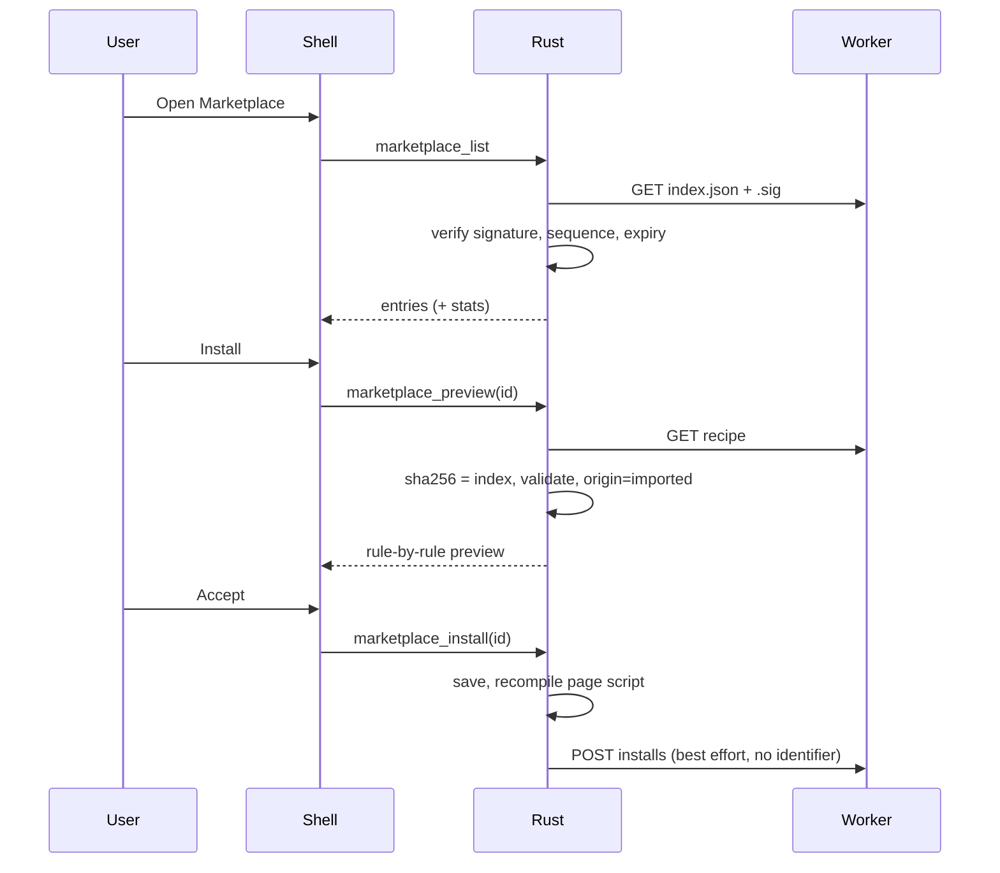

# Recipe Marketplace and Sharing

> **Status: Partially implemented.** Device side (`src-tauri/src/recipes/share.rs`, `src-tauri/src/catalog/`, `src-tauri/src/share_commands.rs`, shell UI in `src/features/marketplace/`) is implemented. The Worker lives in [`openmedia-worker`](https://github.com/skepjandi/openmedia-worker); this branch adds automatic checks, a 14-day public hold and scheduled publishing. The existing Worker and Cloudflare resources are deployed per maintainer report; **this branch's automated publishing path is not deployed or production-verified**. See [Verified results](#verified-results). Decision record: [Roadmap](./roadmap.md#decision-log), 2026-11-10.

Two ways to move recipes between people:

1. **Export / import** of a recipe or bundle, as text. No network.
2. **Marketplace**: an automatically published catalog on Cloudflare. Browse, install, report, submit.

Both end in the same place: a recipe with `origin: imported`, reviewed rule by rule before anything applies.

## Threat model

| Threat | Control |
|---|---|
| A malicious recipe hides a phishing warning or breaks a site | Automatic validation in the Worker before anything is stored; Rust validation again on the device; rule-by-rule review before first apply; `script` rules refused everywhere ([Recipe Format](./recipe-format.md#trust-levels)). **No policy can prove a recipe is benign**: a `hide` rule can match a selector that also covers a security banner, so the app shows every rule instead of a verdict |
| Someone edits files on the server or in transit | Catalog index is signed with Ed25519; the public key is compiled into the app; each recipe is pinned in the index by SHA-256 |
| The Worker or Cloudflare account is compromised | The signing key is a Worker secret, so a compromised Worker can sign its own entries. The app still pins every recipe by SHA-256 in the signed index, re-validates the recipe in Rust and shows every rule before the first apply: the signature proves the catalog came from the Worker, not that a recipe is safe |
| Old signed index replayed to hide a takedown | Monotonic `sequence` (device refuses lower) and `expiresAt` |
| Bad recipe already installed | Signed `revoked` list; the app disables an installed recipe whose `(id, sha256)` appears in it |
| A file import claims to be `bundled` to bypass the broad-match refusal | Import ignores the file's `origin` and sets `imported` before validation |
| A file import overwrites a bundled or marketplace recipe | File imports always get the id prefix `imported.`; `market.` ids are accepted only from the verified catalog path |
| Submission flood | Size cap, per-IP rate limit, a daily cap on submissions, held entries expire |
| Fake install counts | Counts are display-only, approximate, rate limited, and never used for any trust decision |
| Takeover of someone's recipe id | First submitter gets a random edit token (returned once; only its hash is stored on the server). A new version of an id needs the token. The device keeps the token in `catalog-state.json`, not the secret store (that store is keyed per AI provider). A leaked token lets someone submit a new version of that id; it goes through the same automatic validation and the same 14-day hold, so it can never skip the hold |

## Export and import

A bundle is JSON:

```json
{ "openmediaBundle": 1, "recipes": [ { "schema": 1, "id": "…", "…": "…" } ] }
```

- **Export:** one recipe or all the user's own. `forkedFrom` is removed. Copy as text.
- **Import:** paste text. Limits: 1 MiB total, 20 recipes, 256 KiB per recipe. Rust parses with `deny_unknown_fields`, sets `origin: imported`, drops `forkedFrom`, prefixes the id with `imported.`, then runs the normal validation (broad `match` refused, selectors and declarations whitelisted).
- **Review:** the shell shows each recipe's sites, options and every rule (type and selector). Nothing is saved until the user accepts. Accept re-validates from the original text.
- **No key, cookie or setting ever appears in an export.**

## Marketplace

One host, set at build time with `OPENMEDIA_MARKET_URL` (a bare `https://` address; plain `http://` only to `localhost` or a loopback IP, in debug builds only) and `OPENMEDIA_CATALOG_KEYS` (`keyId:base64 public key`, comma-separated to trust several). The public key is the public half of the Worker's signing key; only the Worker holds the private half, as a Cloudflare secret. Both variables are read by `src-tauri/build.rs` from the environment or `.env`, like the billing keys. Without them the Marketplace row is hidden (`marketplace_status.available` is false); Import and export still work. The app talks to it only on user action: opening the Marketplace, installing, reporting, submitting. HTTPS only, no redirects, no cookies, no identifier, every response size-capped, errors that never repeat what the server said.

### Pieces

| Piece | Where | Does |
|---|---|---|
| Worker | separate repo [`skepjandi/openmedia-worker`](https://github.com/skepjandi/openmedia-worker) (Cloudflare Workers) | Serves the signed catalog from R2, accepts submissions and reports, counts installs. It checks every submission automatically, holds the accepted ones for 14 days and publishes them itself, signing the catalog with its own secret key. No admin endpoints |
| R2 bucket | binding `CATALOG` | `index.json`, `index.json.sig`, `recipes/<id>/<version>.json`, `pending/<submission>.json` |
| D1 database | binding `DB` | `submissions`, `owners` (edit-token hashes), `installs`, `reports` |
| App client | `src-tauri/src/catalog/` | Fetch, verify, download, check hash, validate, preview, install |

The Worker repo implements the API below; **this page is the contract**. A change to the API, the index format or the submission limits is made here first, then in both repos. The Worker's name and author limits (60 characters) and its `hide`/`css`-only rule filter must stay equal to the Rust validator's, or the Worker would accept what the device refuses.

### API (all under `/v1`)

| Request | Response |
|---|---|
| `GET /index.json`, `GET /index.json.sig` | Signed catalog (below). Cached at the edge |
| `GET /recipes/<id>/<version>.json` | The exact bytes the index hashes. Immutable, cached |
| `GET /upcoming.json` | `{ "recipes": [{ "id", "name", "version", "author", "summary", "hosts", "submittedAt", "releaseAt", "recipe": { "options", "rules" } }] }`. Dates are Unix seconds. Only the submissions currently held appear, and no edit token is ever in the answer |
| `POST /submissions` `{recipe, summary, editToken?}` | `202 {submissionId, editToken?}`. `editToken` only on first claim of an id. An accepted submission is held for 14 days and then published automatically |
| `POST /reports` `{id, version, reason}` | `202`. Reason is one of a fixed list |
| `POST /recipes/<id>/installs` (empty body) | `204`. Increments one counter |
| `GET /stats.json` | `{ "<id>": installs }`. Unsigned, display only |

Submissions are validated in the Worker by a strict policy (size, JSON, `schema`, `market.` id shape, no `script` rule, and the same limits the Rust validator applies). **A submission that fails any check is rejected before it is stored**: nothing is written to R2 or D1. The device validates the recipe again when it is downloaded, and shows every rule before the first apply. The Worker's check is a policy, not a proof: it cannot tell a recipe that hides a security banner from one that does not.

### Signed index

```json
{
  "format": 1,
  "keyId": "k1",
  "sequence": 42,
  "issuedAt": 1794268800,
  "expiresAt": 1796860800,
  "recipes": [
    { "id": "market.youtube-calm", "name": "…", "version": "1.2.0", "author": "…",
      "summary": "…", "hosts": ["youtube.com"], "sha256": "<hex>", "size": 1834,
      "publishedAt": 1794268800, "featured": false }
  ],
  "revoked": [ { "id": "market.old", "sha256": "<hex>" } ]
}
```

`index.json.sig` is standard base64 of the Ed25519 signature over `"openmedia-catalog-v1\n" || <exact index.json bytes>`. Times are Unix seconds. The private key is a Worker secret (`SIGNING_KEY`, PKCS#8, base64) and `SIGNING_KEY_ID` names it in the index; it never leaves Cloudflare and is never written into a build. The app holds a list of `(keyId, public key)`, so a key can rotate with an app release. It checks the signature against each trusted key **before** parsing the index, then requires the index's `keyId` to name the key that verified.

The app refuses an index that: fails verification, has a `keyId` that does not name the verifying key, has an unknown `format`, is past `expiresAt`, or has a `sequence` lower than the last one it accepted (stored in `catalog-state.json`). It also refuses an index with duplicate ids, ids not under `market.`, a `sha256` that is not 64 lowercase hex characters, or entry text that cannot be shown safely.

### Install flow



### Submit flow

The user picks one of their own recipes and a one-line summary. Rust sends it. The Worker checks it against that validation policy and rejects it before anything is stored if it fails. **No person reviews it.** An accepted submission is held: it appears at once in the public Upcoming feed (`GET /v1/upcoming.json`) with `releaseAt = submittedAt + 14 days`, and a scheduled Worker promotion publishes the matured entries and signs the new catalog. Until an update publishes, the current published version stays available. A new version of a published id needs the edit token.

Existing D1 submissions migrate to the held state and start a fresh 14-day clock at migration time, so a pending entry that was never checked is never published silently.

### Privacy

- The device sends nothing until the user opens the Marketplace. Then it fetches the signed catalog; visible recipe rows may also fetch a site's favicon directly from its first valid HTTPS host if that icon is not cached. That site sees the device's connection and IP address. Installs send the recipe id only. Submissions send what the user chose to share.
- No account, device id, or analytics SDK. The Worker stores no IP address, and Workers Logs stay off. Cloudflare itself necessarily sees the connection (the same is true of any host); the store privacy label and privacy page must say so.
- The user can turn install counting off on the Marketplace page (`marketplace_set_counting`). The install is then not reported.

### Store policy

A catalog of user-submitted content counts as user-generated content for App Store and Play review. **This design does not claim to satisfy either store's rules.** Automatic schema and risk checks are not reliable detection of harmful or deceptive intent; the public 14-day hold is not moderation.

- **Apple, App Store Review Guideline 1.2 (User-Generated Content)** (<https://developer.apple.com/app-store/review/guidelines/#user-generated-content>): a method to filter objectionable material before posting, report content with timely responses, block abusive users and publish contact details. The Worker rejects invalid recipe structures before storage, but those checks cannot reliably detect objectionable or deceptive recipes.
- **Google Play, User Generated Content policy** (<https://support.google.com/googleplay/android-developer/answer/9876937>): users must accept terms before uploading; the service needs robust, effective, ongoing moderation, in-app reporting and blocking controls. This design has no upload-time terms acceptance, human moderation or user-to-user blocking.

What exists today: an in-app report action (`POST /reports`), removal of a recipe through the signed revocation list and through editing D1 and the catalog by an operator, and a public 14-day window in which a report can arrive before a recipe is published. What does **not** exist: a person reviewing each submission, and a way for one user to block another submitter.

**Open risk.** The stores may reject this design because automated structural checks cannot reliably screen objectionable content, and the app has no user-blocking control. Re-read both policies before submitting; the current design intentionally has no human approval step.

### Cost (estimates, Cloudflare list prices checked 2026-11-10)

Recipes are a few KB, so storage is negligible. Assumptions: 4 catalog opens and 5 installs per monthly active user per month; Worker requests dominate.

| Monthly active users | Worker requests / month | D1 writes / month | Plan | Estimate |
|---|---|---|---|---|
| 100k | about 1.3M | about 0.5M | Free tier covers it (100k requests/day, 100k D1 writes/day) | $0, or $5 for headroom |
| 1M | about 13M | about 5M | Workers Paid ($5 incl. 10M requests, 50M D1 writes) | about $6–10 |

Sources: Workers, D1 and R2 pricing pages. Egress is free on R2 and D1. The cost is infrastructure only: there is no person in the loop, and the 14-day hold adds one stored row and one scheduled promotion per submission.

## Verified results

2026-11-10 pre-automation baseline, verified locally on a Mac. The maintainer later reported the original Worker and Cloudflare resources deployed; this branch's automation is not production-verified.

- **App repo, full contract:** `yarn verify` passed (`ts:check`, `lint`, `format:check`, `suffix:check`, 302 Vitest tests incl. every locale's keys; `cargo fmt --check`, `cargo clippy --workspace --all-targets -D warnings`, 238 app tests, 29 siteview tests). The curator CLI and its 43 tests were removed afterwards; the app and siteview counts above are the ones that remain.
- **Shell UI:** the new screens are type-checked and linted but **not rendered or driven** on a device, a simulator or in a browser.
- **Worker:** its own 61 tests in `openmedia-worker`.
- **Wire contract, end to end, against the Worker as it was then:** the real Worker code and D1 migration run under `wrangler dev --local`, driven by the real Rust client against an index signed by the Rust signer. Confirmed: signed index verifies; a recipe download is tied to its signed entry; an index signed by another key is refused; an install is counted (the `installs` row was checked in D1; `/v1/stats.json` is edge-cached for 10 minutes, so the number lags); an unpublished id cannot be counted; a first submission returns an edit token and stores only its 64-character hash; a repeat without the token is refused; with it, it is queued and no new token is issued; a report is stored. D1 has no IP or user-agent column.

**Not verified:** any deploy; the automatic publication path (the 14-day hold, the Upcoming feed, the scheduled promotion and the migration of the existing rows to `held`); the rate-limit binding on the Workers Free plan (the Cloudflare docs do not say; the Worker's README documents a WAF rate-limiting rule as the alternative if it is unavailable); edge caching behaviour in production; behaviour on iOS, Android or macOS; App Store and Play review of user-generated content.

## Not in scope

Ratings and reviews, accounts, payments for recipes, paid creators, `script` rules, any ranking that uses install counts for trust. **Out of scope in the other direction too:** there is no manual approval queue, no moderator and no signed-by-a-person step, and no public moderation or takedown endpoint — a takedown is an operator editing D1 and the catalog.

## See Also

[Recipe Format](./recipe-format.md) · [Security](./security.md) · [Roadmap](./roadmap.md)
