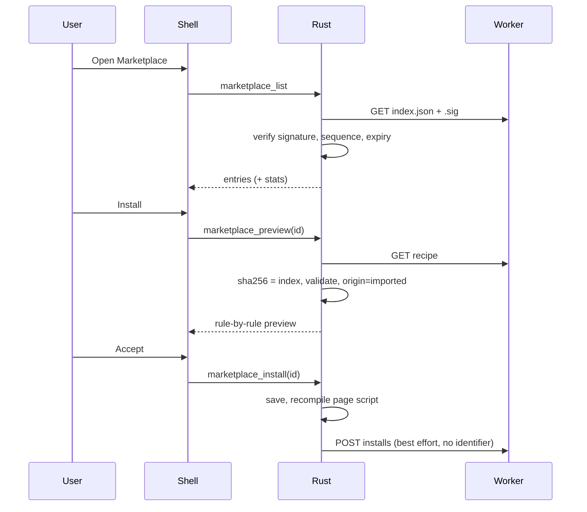

# Recipe Marketplace and Sharing

> **Status: Partially implemented.** Device side (`src-tauri/src/recipes/share.rs`, `src-tauri/src/catalog/`, `src-tauri/src/share_commands.rs`, shell UI in `src/features/marketplace/`) and the curator CLI (`src-tauri/tools/curator/`, see its README) are implemented. The Worker lives in [`openmedia-worker`](https://github.com/skepjandi/openmedia-worker). **Nothing is deployed** and no Cloudflare resource exists yet; the only end-to-end run was against a local Worker (see [Verified results](#verified-results)). Decision record: [Roadmap](./roadmap.md#decision-log), 2026-11-10.

Two ways to move recipes between people:

1. **Export / import** of a recipe or bundle, as text. No network.
2. **Marketplace**: a curated catalog on Cloudflare. Browse, install, report, submit.

Both end in the same place: a recipe with `origin: imported`, reviewed rule by rule before anything applies.

## Threat model

| Threat | Control |
|---|---|
| A malicious recipe hides a phishing warning or breaks a site | Human review before publish; Rust validation again on the device; rule-by-rule review before first apply; `script` rules refused everywhere ([Recipe Format](./recipe-format.md#trust-levels)) |
| Someone edits files on the server or in transit | Catalog index is signed with Ed25519; the public key is compiled into the app; each recipe is pinned in the index by SHA-256 |
| The Worker or Cloudflare account is compromised | The signing key is **not** on Cloudflare. It lives with the curator, offline. A compromised Worker can withhold or delay, not forge |
| Old signed index replayed to hide a takedown | Monotonic `sequence` (device refuses lower) and `expiresAt` |
| Bad recipe already installed | Signed `revoked` list; the app disables an installed recipe whose `(id, sha256)` appears in it |
| A file import claims to be `bundled` to bypass the broad-match refusal | Import ignores the file's `origin` and sets `imported` before validation |
| A file import overwrites a bundled or marketplace recipe | File imports always get the id prefix `imported.`; `market.` ids are accepted only from the verified catalog path |
| Submission flood | Size cap, per-IP rate limit, a daily cap on pending submissions, pending entries expire |
| Fake install counts | Counts are display-only, approximate, rate limited, and never used for any trust decision |
| Takeover of someone's recipe id | First submitter gets a random edit token (returned once; only its hash is stored on the server). A new version of an id needs the token. The device keeps the token in `catalog-state.json`, not the secret store (that store is keyed per AI provider). A leaked token lets someone queue a new version for the same human review; it can never publish |

## Export and import

A bundle is JSON:

```json
{ "openmediaBundle": 1, "recipes": [ { "schema": 1, "id": "…", "…": "…" } ] }
```

- **Export:** one recipe or all the user's own. `forkedFrom` is removed. Copy as text.
- **Import:** paste text. Limits: 1 MiB total, 20 recipes, 256 KiB per recipe. Rust parses with `deny_unknown_fields`, sets `origin: imported`, drops `forkedFrom`, prefixes the id with `imported.`, then runs the normal validation (broad `match` refused, selectors and declarations whitelisted).
- **Review:** the shell shows each recipe's sites, options and every rule (type and selector). Nothing is saved until the user accepts. Accept re-validates from the original text.
- **No key, cookie or setting ever appears in an export.**

## Marketplace

One host, set at build time with `OPENMEDIA_MARKET_URL` (a bare `https://` address; plain `http://` only to `localhost` or a loopback IP, in debug builds only) and `OPENMEDIA_CATALOG_KEYS` (`keyId:base64 public key`, comma-separated to trust several; produced by `curator keygen`). Both are read by `src-tauri/build.rs` from the environment or `.env`, like the billing keys. Without them the Marketplace row is hidden (`marketplace_status.available` is false); Import and export still work. The app talks to it only on user action: opening the Marketplace, installing, reporting, submitting. HTTPS only, no redirects, no cookies, no identifier, every response size-capped, errors that never repeat what the server said.

### Pieces

| Piece | Where | Does |
|---|---|---|
| Worker | separate repo [`skepjandi/openmedia-worker`](https://github.com/skepjandi/openmedia-worker) (Cloudflare Workers) | Serves the signed catalog from R2, accepts submissions and reports, counts installs. No admin endpoints, no signing key |
| R2 bucket | binding `CATALOG` | `index.json`, `index.json.sig`, `recipes/<id>/<version>.json`, `pending/<submission>.json` |
| D1 database | binding `DB` | `submissions`, `owners` (edit-token hashes), `installs`, `reports` |
| Curator CLI | `src-tauri/tools/curator/` | Run by a maintainer. Lists pending, validates with the app's own Rust validator, approves, rejects, revokes, signs the index, uploads through `wrangler` |
| App client | `src-tauri/src/catalog/` | Fetch, verify, download, check hash, validate, preview, install |

The Worker repo implements the API below; **this page is the contract**. A change to the API, the index format or the submission limits is made here first, then in both repos. The Worker's name and author limits (60 characters) and its `hide`/`css`-only rule filter must stay equal to the Rust validator's, or the Worker would accept what the curator and the device refuse.

### API (all under `/v1`)

| Request | Response |
|---|---|
| `GET /index.json`, `GET /index.json.sig` | Signed catalog (below). Cached at the edge |
| `GET /recipes/<id>/<version>.json` | The exact bytes the index hashes. Immutable, cached |
| `POST /submissions` `{recipe, summary, editToken?}` | `202 {submissionId, editToken?}`. `editToken` only on first claim of an id |
| `POST /reports` `{id, version, reason}` | `202`. Reason is one of a fixed list |
| `POST /recipes/<id>/installs` (empty body) | `204`. Increments one counter |
| `GET /stats.json` | `{ "<id>": installs }`. Unsigned, display only |

Submissions are validated cheaply in the Worker (size, JSON, `schema`, `market.` id shape, no `script` rule) as a filter only. The curator's Rust validation is the authority, and the device validates again.

### Signed index

```json
{
  "format": 1,
  "keyId": "k1",
  "sequence": 42,
  "issuedAt": 1794268800,
  "expiresAt": 1796860800,
  "recipes": [
    { "id": "market.youtube-calm", "name": "…", "version": "1.2.0", "author": "…",
      "summary": "…", "hosts": ["youtube.com"], "sha256": "<hex>", "size": 1834,
      "publishedAt": 1794268800, "featured": false }
  ],
  "revoked": [ { "id": "market.old", "sha256": "<hex>" } ]
}
```

`index.json.sig` is standard base64 of the Ed25519 signature over `"openmedia-catalog-v1\n" || <exact index.json bytes>`. Times are Unix seconds. The app holds a list of `(keyId, public key)`, so a key can rotate with an app release. It checks the signature against each trusted key **before** parsing the index, then requires the index's `keyId` to name the key that verified.

The app refuses an index that: fails verification, has a `keyId` that does not name the verifying key, has an unknown `format`, is past `expiresAt`, or has a `sequence` lower than the last one it accepted (stored in `catalog-state.json`). It also refuses an index with duplicate ids, ids not under `market.`, a `sha256` that is not 64 lowercase hex characters, or entry text that cannot be shown safely.

### Install flow



### Submit flow

The user picks one of their own recipes and a one-line summary. Rust sends it. The curator reviews it (rules, selectors, scope of `match`, whether it hides anything security-relevant) and approves, or rejects with a note. Publishing is never automatic. A new version of a published id needs the edit token.

### Privacy

- The device sends: nothing until the user opens the Marketplace. Then a GET. Installs send the recipe id only. Submissions send what the user chose to share.
- No account, device id, or analytics SDK. The Worker stores no IP address, and Workers Logs stay off. Cloudflare itself necessarily sees the connection (the same is true of any host); the store privacy label and privacy page must say so.
- The user can turn install counting off on the Marketplace page (`marketplace_set_counting`). The install is then not reported.

### Store policy

A catalog of user-submitted content counts as user-generated content for App Store and Play review. Expect to need: pre-publication review (present), an in-app report action (`POST /reports`), the ability to remove content and block a submitter (revocation list), and published contact details. **[INFERENCE]** based on App Store Review Guideline 1.2; check the current text before submission.

### Cost (estimates, Cloudflare list prices checked 2026-11-10)

Recipes are a few KB, so storage is negligible. Assumptions: 4 catalog opens and 5 installs per monthly active user per month; Worker requests dominate.

| Monthly active users | Worker requests / month | D1 writes / month | Plan | Estimate |
|---|---|---|---|---|
| 100k | about 1.3M | about 0.5M | Free tier covers it (100k requests/day, 100k D1 writes/day) | $0, or $5 for headroom |
| 1M | about 13M | about 5M | Workers Paid ($5 incl. 10M requests, 50M D1 writes) | about $6–10 |

Sources: Workers, D1 and R2 pricing pages. Egress is free on R2 and D1. The real cost is curator time, not infrastructure.

## Verified results

2026-11-10, on a Mac, nothing deployed:

- **App repo, full contract:** `yarn verify` passed (`ts:check`, `lint`, `format:check`, `suffix:check`, 302 Vitest tests incl. every locale's keys; `cargo fmt --check`, `cargo clippy --workspace --all-targets -D warnings`, 238 app tests, 43 curator tests, 29 siteview tests).
- **Shell UI:** the new screens are type-checked and linted but **not rendered or driven** on a device, a simulator or in a browser.
- **Worker:** its own 61 tests in `openmedia-worker`.
- **Wire contract, end to end:** the real Worker code and D1 migration run under `wrangler dev --local`, driven by the real Rust client against an index signed by the Rust signer. Confirmed: signed index verifies; a recipe download is tied to its signed entry; an index signed by another key is refused; an install is counted (the `installs` row was checked in D1; `/v1/stats.json` is edge-cached for 10 minutes, so the number lags); an unpublished id cannot be counted; a first submission returns an edit token and stores only its 64-character hash; a repeat without the token is refused; with it, it is queued and no new token is issued; a report is stored. D1 has no IP or user-agent column.

**Not verified:** any deploy; the rate-limit binding on the Workers Free plan (the Cloudflare docs do not say; the Worker's README documents a WAF rate-limiting rule as the alternative if it is unavailable); the curator against a real `wrangler` and bucket; edge caching behaviour in production; behaviour on iOS, Android or macOS; App Store and Play review of user-generated content.

## Not in scope

Ratings and reviews, accounts, payments for recipes, paid creators, auto-publishing, `script` rules, any ranking that uses install counts for trust.

## See Also

[Recipe Format](./recipe-format.md) · [Security](./security.md) · [Roadmap](./roadmap.md)
