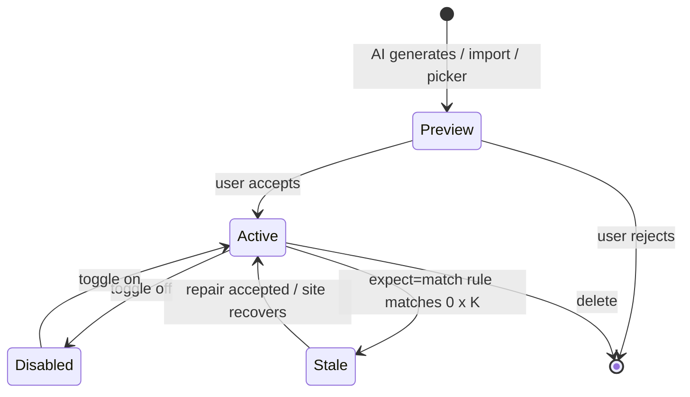

# Recipe Format

> **Status: Design.** The schema below is the intended v1. The Rust types in `src-tauri/src/recipes/schema.rs` will become the source of truth; update this page when they land.

A **recipe** is a JSON document describing how to modify one site (or a set of URL patterns). Declarative on purpose: the AI emits it, Rust validates it, the engine applies it, and users can read, toggle, edit, export, and share it.

## Why declarative, not scripts

- **Safe for AI output.** A rule list can be schema-validated; arbitrary JS cannot.
- **Inspectable.** Users see "Hide: Reels tab" with a toggle, not a code blob.
- **Repairable.** When a site changes, a failed rule is identifiable and the AI can patch just that rule.
- **CSS-first.** Most rules compile to a stylesheet that applies before first paint, so removed things never flash.

A `script` rule exists as a gated escape hatch (see [Trust levels](#trust-levels)).

## Shape

```json
{
  "schema": 1,
  "id": "instagram.no-reels",
  "name": "Instagram without Reels",
  "version": "1.0.0",
  "origin": "bundled",
  "match": ["https://www.instagram.com/*"],
  "rules": [
    {
      "id": "nav-reels",
      "label": "Reels tab",
      "type": "hide",
      "target": { "ariaLabel": "Reels", "closest": "a" }
    },
    {
      "id": "reels-route",
      "label": "Redirect /reels to home",
      "type": "redirect",
      "when": { "path": "/reels/**" },
      "to": "/"
    }
  ]
}
```

### Top-level fields

| Field | Type | Notes |
|-------|------|-------|
| `schema` | integer | Format version. Unknown higher version → recipe refused, not guessed at. |
| `id` | string | Stable, `site.slug`. Unique per user. |
| `name` | string | Display name. |
| `version` | semver | Bumped by author/AI on change. |
| `origin` | `bundled` \| `user` \| `ai` \| `imported` | Drives [trust level](#trust-levels). |
| `match` | string[] | URL patterns (scheme + host + path glob). A recipe applies when any matches the top-level page URL. |
| `rules` | Rule[] | Ordered. Each independently toggleable. |
| `meta` | object | Optional: `author`, `homepage`, `lastVerified` (date), `notes`. |

## Targets

A **target** finds elements without relying on obfuscated class names (Instagram, Facebook and X use hashed, rotating classes). Prefer stable semantics: ARIA labels, roles, link destinations, visible text.

| Field | Meaning |
|-------|---------|
| `css` | Candidate selector. Default `*`. Use for structural anchors (`nav`, `[role=tablist]`, `ytd-reel-shelf-renderer`). |
| `ariaLabel` | Exact or `{ "contains": "..." }` match on `aria-label`. |
| `role` | ARIA role or implicit role of candidate. |
| `href` | `{ "prefix": "/reels" }`, `{ "equals": ... }` or `{ "contains": ... }` on the `href` path (query ignored). |
| `text` | `{ "equals": "Reels" }`, `{ "contains": ... }`, `{ "regex": ... }` on visible text. Case-insensitive by default. |
| `has` | A nested target the candidate must contain (maps to `:has()`). |
| `closest` | After matching, act on the nearest ancestor matching this selector (find the link by its label, hide the whole nav item). |

All specified fields must match (AND). A rule may list several targets (OR) via `targets: [...]`.

Resolution order: engine picks candidates by `css`, filters by the semantic fields, then walks to `closest`. Pure-CSS targets (`css` + `has` + `href`/`ariaLabel` exact forms) compile to a stylesheet; anything needing text matching is evaluated by a throttled observer.

## Rule types (v1)

| Type | Effect | Notes |
|------|--------|-------|
| `hide` | `display: none !important` on matched elements | Reversible; element stays in DOM so site code doesn't break. **Default choice.** |
| `remove` | Detach matched elements from DOM | For when hidden elements still take effect (autoplay, layout). Can break site JS; use sparingly. |
| `css` | Inject a declarations block for a target or a global stylesheet | Whitelist of properties; no `url()`, `@import`, or `expression`. |
| `redirect` | If current path matches `when.path`, navigate to `to` | Route guard (e.g. `/reels/**` → `/`). Same-origin only. |
| `media` | `{ "autoplay": "off", "loop": "off" }` etc. on `<video>` | Pause autoplay, stop looping. |
| `script` | Run JS in the page | **Gated.** Requires per-recipe user confirmation, never auto-applied. Never AI-applied silently. |

Deferred to later versions: `limit` (daily allowance by count/minutes, local counters), `scroll-stop` (cap infinite scroll), `text-replace`.

## Conditions

Any rule may carry `when`:

| Field | Meaning |
|-------|---------|
| `path` | Glob on `location.pathname` (`/reels/**`, `/`, `/watch`). Supports `!` negation. |
| `viewport` | `mobile` \| `desktop` (the site often serves different DOM per width). |
| `loggedIn` | Not supported v1; sites differ too much. |

## Health

Each rule may declare `expect`: `"match"` (should match ≥1 element on pages satisfying `when`) or `"none"` (best-effort). The engine reports match counts to Core. A rule with `expect: "match"` that matches 0 on K consecutive eligible page loads is marked **stale** in the UI, and offers "Repair with AI" (re-snapshot, ask for a replacement for that rule only). Bundled recipes use this as their breakage detector in the field, with no telemetry: the state is local and shown to the user.

## Trust levels

| Origin | Allowed rule types | Apply policy |
|--------|--------------------|--------------|
| `bundled` | all except `script` | Applied on enable. Shipped with and verified by the app build. |
| `user` (picker / manual) | all except `script` | Applied immediately. |
| `ai` | all except `script` | Shown as **preview** first; saved on user accept. |
| `imported` | all except `script` | Shown with a rule-by-rule review before first apply. |
| any + `script` | `script` | Per-recipe explicit confirmation with the code shown; confirmation stored keyed by a hash of the script. Changing the script re-prompts. |

## Validation (Rust, before anything reaches a webview)

- Parse with `serde` (`deny_unknown_fields`) → typed `Recipe`.
- Check `schema` version, id/rule-id uniqueness, `match` patterns well-formed and not overly broad (a bare `*` or `https://*/*` is refused for AI/imported recipes).
- Compile every selector with a safe-subset parser; reject selectors that are pathological (deep `:has()` nesting, huge unions).
- `css` rules: property whitelist, value sanitizer.
- `redirect`: same-origin target only.
- Cap rule count (default 200) and recipe size.

## Versioning and migration

- `schema` is the format version. Bump on breaking change; ship a Rust migration `vN → vN+1`; saved recipes are migrated on load and re-saved.
- `version` is the recipe's own semver, used to compare bundled updates against a user-modified copy (user edits fork the bundled recipe into a `user` recipe; the bundled one keeps updating).

## Lifecycle of a recipe



## Inspirations

Cosmetic filters in content blockers (selector + `:has-text`-style predicates), userstyles, and userscript managers. The target model here is deliberately a small, validated subset of those.

## See Also

[Site Runtime](./site-runtime.md) · [AI Assistant](./ai-assistant.md) · [Security](./security.md)
