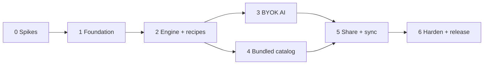

# Roadmap

> **Status: Design.** Current phase: **0 — Feasibility spikes** (not started). Update this page when phases start, finish, or change.

## Goal

A Tauri v2 app (macOS, iOS, Android first; Windows/Linux after) where the user opens any site and reshapes it. Bundled recipes cover popular sites; an AI assistant using the user's own key writes recipes for anything else. No backend.

## Principles

1. **Prove the risky parts first.** Mobile site view, the bridge, and key storage can each invalidate the architecture. They go before any UI polish.
2. **Vertical slice early.** "Hide Reels on Instagram, on macOS + iOS + Android, from a hardcoded recipe" before building the editor, the AI, or the catalog.
3. **No-AI path stands alone.** Bundled recipes and the picker must be useful without a key.
4. **Recipe format is the product.** Everything else is a way to author, apply, or repair recipes.

## Overview

Phases 3 and 4 are independent after Phase 2 and can run in parallel.

---

## Phase 0 — Feasibility spikes

Throwaway code in a `spikes/` branch/worktree (not merged to `main`); outputs are **recorded results** in [Platform Support](./platform-support.md), the decision log below, and updated wiki pages. Target: ~2 weeks.

| ID | Spike | Question answered | Pass criteria |
|----|-------|-------------------|---------------|
| S1 | Desktop site view (macOS) | Does `add_child` + `initialization_script` host Instagram and YouTube, log in, and inject at document start? | Logged-in Instagram web renders in a child webview; a hardcoded CSS rule hides the Reels nav item with no visible flash on cold load and on SPA navigation |
| S2 | The bridge | Can the engine send messages to Core without general IPC exposure? | Engine posts a message that Core receives; **a negative test proves a site view cannot invoke any other command**. Chosen option recorded in [Security](./security.md#the-bridge-open-decision) |
| S3 | iOS native site view | Can an in-repo plugin host a `WKWebView` above the Tauri webview, positioned by a shell-reported rect? | Rect follows layout changes, rotation, keyboard; `WKUserScript` injection works; script message handler delivers to Rust |
| S4 | Android native site view | Same as S3 on Android; document-start injection support | Same pass criteria; document whether `addDocumentStartJavaScript` is available and what the fallback costs |
| S5 | Profile isolation | Separate cookie jars per profile on each platform | Log in as account A in profile 1; profile 2 is logged out. Record min OS versions and fallbacks |
| S6 | Secret store | Is there a backing that satisfies the invariants on desktop, iOS, Android? | Round-trip a test secret on all three; confirm not in plain files/backups; verdict: adopt plugin X or write thin in-repo plugin |
| S7 | LLM → rule feasibility | Given a pruned snapshot of real Instagram/YouTube pages, do current models produce usable targets? | Manual harness (not product code): ≥ 80% of 20 sample requests yield rules that match intended elements using stable semantics, not hashed classes. Informs snapshot format |

**Phase 0 exit (decision gate):**

- S1 + S2 + S3 pass → proceed as designed.
- S3 or S4 fails → evaluate alternatives before Phase 1: (a) different native-embedding approach, (b) ship desktop first, mobile later, (c) reconsider Tauri for mobile. **Stop and re-plan; do not push on.**
- S2 shows no safe desktop bridge → desktop adopts native-channel design (Bridge B equivalent).
- S7 fails → snapshot/prompt redesign before Phase 3; Phases 1–2 and 4 unaffected.

## Phase 1 — Foundation

Scaffold the real project and the guardrails.

- Tauri v2 + React/TS/Vite + Rust core scaffold; yarn; strict TS; clippy `-D warnings`.
- CI (`.github/workflows/ci.yml`): `ts:check`, `lint`, `format:check`, `test`, `cargo fmt/clippy/test`. Husky/lint-staged if desired.
- `SiteView` trait + desktop implementation + iOS/Android plugin skeletons from the spike learnings (rewritten cleanly, not copy-pasted spike code).
- The chosen bridge, with the negative-IPC integration test as a permanent regression test.
- Shell: home (site list), browser view (address bar, back/forward/reload, tabs), settings skeleton.
- Profiles (create, name, isolated store), per-profile site list.
- Settings/recipes persistence in app data dir.
- App icons: generate all platform icons from `assets/logo.svg` with `yarn tauri icon`. The source logo is not square and has wide margins, so first add a square, padded 1024×1024 master (e.g. `assets/icon-source.svg`) rather than editing `logo.svg`; check the result at small sizes and in the iOS rounded-mask and Android adaptive-icon safe zones.
- Flip [Development Guide](./development-guide.md), [Architecture](./architecture.md), [Platform Support](./platform-support.md) to `Implemented` where true.

**Exit:** open any URL in a profile on macOS, iOS and Android simulators/devices; navigation works; sessions persist per profile; CI green.

## Phase 2 — Engine and recipes

The vertical slice, then breadth.

- Recipe schema in Rust (`serde` + `schemars`), JSON Schema export, generated TS types, validator, migrations scaffold ([Recipe Format](./recipe-format.md)).
- Recipe store + URL resolution + merged bundle.
- Engine: CSS-first application, observer fallback, SPA navigation, `hide`/`remove`/`css`/`redirect`/`media`, reversibility, circuit breaker ([Site Runtime](./site-runtime.md)).
- Match reporting → rule health, stale detection.
- **First hand-written bundled recipe: Instagram without Reels**, with DOM fixtures and a fixture test.
- Customize panel: rule list, toggles, delete, undo.
- **Element picker** (no AI): tap element → proposed target → `hide` rule.
- Engine test harness: Playwright loads fixtures with the engine, asserts hidden/remaining sets.

**Exit:** on all three platforms, Instagram web shows no Reels tab and `/reels` redirects home, applied before first paint; user can toggle the rule, add a picker rule, and see staleness when a fixture simulates a site change.

## Phase 3 — BYOK AI assistant

- `SecretStore` implementation per S6; key management UI (add, test, delete).
- Provider trait + adapters: Anthropic, OpenAI, Gemini, OpenRouter, OpenAI-compatible custom base URL ([AI Assistant](./ai-assistant.md)).
- Snapshot + two-pass redaction + preview-before-send UI.
- Prompt contract v1, patch schema, validation, retry-once.
- Preview → match report → repair loop (max 2) → accept/reject.
- Repair of stale rules.
- Error taxonomy in the UI; token estimate and size cap.
- Fixture-driven tests; recorded provider fixtures; redaction property tests.
- Manual evaluation script comparing providers on the fixture set.

**Exit:** with a user key, "remove the Reels tab and suggested posts" on a never-before-seen site yields a previewable recipe that the user can accept; invalid or zero-match output never silently applies; key never appears in any webview, log, or file (verified by test and by grep of app data after a run).

## Phase 4 — Bundled catalog (parallel with 3)

Curated, fixture-tested recipes. Order by value and breakability:

1. Instagram (Reels, Explore, suggested posts)
2. YouTube (Shorts shelf/tab, recommendations sidebar, autoplay)
3. X / Twitter (For You, trends, who-to-follow)
4. Facebook (Reels, Watch, Marketplace, suggested)
5. TikTok web (limited; feed is the product, so mostly cosmetic)
6. Reddit (popular/all, promoted, suggested communities)
7. LinkedIn (feed noise, promoted)
8. Snapchat web, Pinterest, Threads

Per site: recipe + scrubbed fixtures + fixture test + `lastVerified`. A "Recipes" browser in the shell with per-site toggles per rule, so users do not need to know recipes exist.

**Exit:** the catalog for sites 1–4 passes fixture tests; each rule shows human-readable labels and toggles; stale detection works on real drift.

## Phase 5 — Sharing and optional sync

All without a backend.

- Export/import single recipes and bundles (`.json`), rule-by-rule review on import.
- Community recipe index: a public GitHub repo of recipe files + generated index; app fetches it on user action; pinned commit or signed index; author shown; review UI before apply.
- Recipe update flow: bundled recipe updates vs user forks.
- Optional user-owned sync: sync recipe/settings folder to a user-provided git repo or file location. Never includes keys or cookies.
- Deferred rule types evaluated here: `limit` (daily allowance), `scroll-stop`.

**Exit:** a recipe made on one device installs on another through export/import and through the community index, with review.

## Phase 6 — Hardening and release

- Security review against [Security](./security.md); re-run IPC negative tests; dependency audit (`cargo audit`, `yarn audit`); `SECURITY.md`.
- Accessibility pass on the shell; i18n scaffolding (English first).
- Windows and Linux builds and per-platform workarounds.
- Signing and notarization (macOS), Windows signing, Android keystore, iOS provisioning; secrets in CI secret store only.
- Desktop auto-update via `tauri-plugin-updater` against GitHub Releases (static `latest.json`; updater private key held offline/in CI secrets).
- Store submissions (App Store, Play); privacy labels ("no data collected"; the snapshot goes to the user's chosen provider on explicit action, disclose it).
- Public README, screenshots, contribution guide for recipes.

**Exit:** signed builds on all platforms; store submissions accepted or feedback addressed.

---

## Decision log

| Date | Decision | Why | Revisit if |
|------|----------|-----|-----------|
| 2026-11-07 | Tauri v2 for desktop and mobile | User preference; one Rust core, one shell | S3/S4 fail |
| 2026-11-07 | Site view = separate native webview loading the real site; not iframe, not proxy | Frame-blocking headers; no backend; user logs in to real origin | — |
| 2026-11-07 | Mobile site view via in-repo native plugin (Swift/Kotlin) | `add_child` is desktop-only upstream | Upstream ships mobile multiwebview |
| 2026-11-07 | Declarative recipes; AI emits patches, never scripts | Validatable, inspectable, repairable, safe | — |
| 2026-11-07 | LLM calls from Rust, key in OS secure store, never in webview | No CORS issue; key isolation | — |
| 2026-11-07 | Schema owned by Rust; TS generated | AI output arrives in Rust; one validator | — |
| 2026-11-07 | No push notifications, parent/family plans, or accounts | Require a backend | A backend decision is made |
| 2026-11-07 | Do not use Android Accessibility to block native apps | Policy and trust cost; out of scope | User demand |
| 2026-11-07 | Defaults: React, Zustand, Tailwind, yarn, Vitest, Playwright | Boring; yarn matches the author's other projects | Before Phase 1 only; cheap to change until the scaffold exists |

## Open questions

1. **Bridge mechanism** (S2): remote-capability command vs native channel on desktop.
2. **Secret store** (S6): adopt third-party plugin vs in-repo.
3. **Minimum iOS version**: iOS 17 gives `WKWebsiteDataStore(forIdentifier:)`; older gives one profile.
4. **Do we support multiple tabs per profile on mobile in v1?** Memory and plugin complexity; start with one active site view plus a lightweight switcher.
5. **Licensing**: choose a license before opening to contributors (not yet decided).
6. **Monetization**: none assumed. Not planned; no code depends on it.
7. **Bundled recipe maintenance**: who keeps Instagram's recipe alive when the site changes? Stale detection plus community PRs; define the contribution flow in Phase 5.

## Risk register

| Risk | Likelihood | Impact | Mitigation |
|------|-----------|--------|------------|
| Mobile native webview hosting is fragile (layout, gestures, lifecycle) | Medium | High | Phase 0 S3/S4 gate; keep plugin surface tiny |
| Sites change DOM and break recipes constantly | High | Medium | Semantic targets, health/stale detection, AI repair, fixtures, community PRs |
| Remote-origin IPC misconfiguration exposes native commands | Low (if tested) | Critical | Bridge design, negative integration test, pinned patched Tauri |
| LLM output quality varies across models | Medium | Medium | Structured output + validation + repair loop; S7; per-provider eval script |
| Snapshot leaks private content to provider | Medium | High | Two-pass redaction, preview default-on, local-model option, docs |
| App Store rejects as a web wrapper | Medium | High | Native functionality is real (profiles, picker, editor, AI); verify guidelines before submit [INFERENCE] |
| Site ToS enforcement / anti-bot challenges | Medium | Medium | Customize-only; no automation; no UA spoofing |
| "Sign in with Google" unavailable in embedded webviews | High for affected sites | Low–Medium | Document; handle via system-browser handoff later if needed |
| `unstable` Tauri feature changes between releases | Medium | Medium | Pin Tauri version; isolate behind `SiteView`; track upstream |
| Third-party secret-store plugin is unmaintained | Medium | High | Trait abstraction; thin in-repo option |
